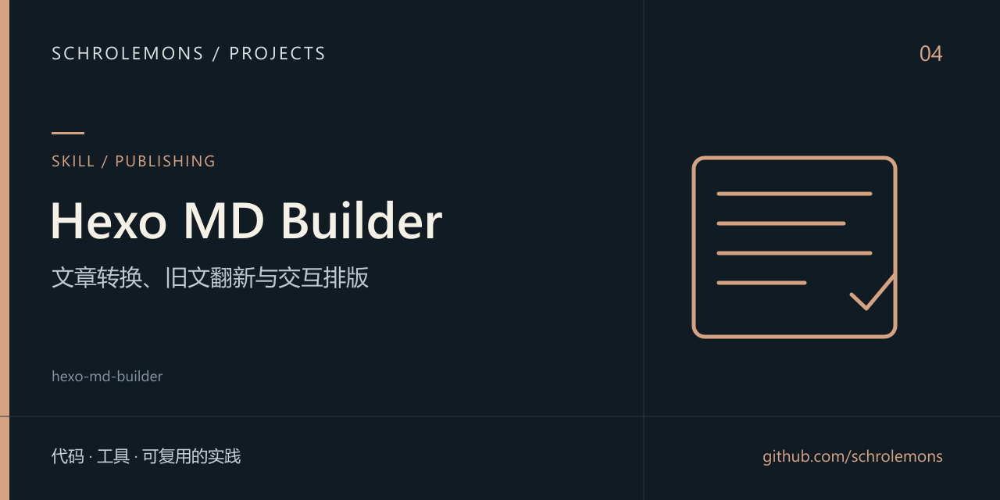

# Hexo MD 构建器（hexo-md-builder）



[技能入口](SKILL.md) · [维护与检查](docs/MAINTENANCE.md) · [问题反馈](https://github.com/schrolemons/hexo-md-builder/issues)

一个 Trae IDE Skill，专为 Hexo 博客的 Markdown 文章构建与美化而生。

## 功能速览

| 功能 | 说明 |
|------|------|
| **Word → MD** | 将 Word 文档转为 Hexo 格式 Markdown，自动生成 frontmatter |
| **MD 翻新** | 翻新旧 MD 的排版格式（自动创建备份，不覆盖原文） |
| **标题智能识别** | 即使 Word 中未使用标准标题样式，也能推断层级结构 |
| **Note 块排版** | 使用 Butterfly/NexT 的 note 标签美化文章层次 |
| **SweetAlert 弹窗** | 为术语、世界观词条添加交互式解释弹窗 |
| **文末附表** | 自动附加内容总结、情节速览、操作速查等概括性附录 |
| **HTML 预览** | 可选生成带交互动画的微缩 HTML 预览页面 |
| **语法验证** | 使用 `hexo clean && hexo g` 自动校验生成结果 |
| **中文排版规范** | 自动处理中英文空格、全角标点、专有名词大小写 |

## 使用场景

- 将 Word 写的文章转为 Hexo 博客的 Markdown 文件
- 翻新旧文章的排版，添加 note 块、弹窗、附表
- 为世界观创作类文章添加术语弹窗解释
- 为教程类文章生成操作速查表和 FAQ

## 文件结构

```
hexo-md-builder/
├── SKILL.md                          # Skill 主文件
└── references/
    ├── hexo-syntax-guide.md          # Hexo 标签语法参考
    ├── sweetalert-usage.md           # SweetAlert 弹窗使用指南
    ├── formatting-examples.md        # 排版美化示例集
    ├── html-preview-template.md      # HTML 预览页面制作指南
    └── word-to-md-guide.md           # Word 转 MD 深度指南
```

## 安装

将整个 `hexo-md-builder/` 文件夹放入 Trae IDE 的 `.trae/skills/` 目录下即可。

```
.trae/skills/hexo-md-builder/
```

## 要求

- Hexo 博客（Butterfly 或 NexT 主题以获得最佳 note 块效果）
- 使用 SweetAlert 弹窗功能需要主题已引入 sweetalert 和 jQuery


## 从一个任务开始

```sh
git clone https://github.com/schrolemons/hexo-md-builder.git
```

把完整目录放入所用AI工具的技能目录，或让能够读取本地文件的助手直接读取[SKILL.md](SKILL.md)。仓库中的安装示例最初面向Trae；其他客户端请按自己的技能机制指定目录。

示例任务：

> 将我提供的Word文章转换成Hexo Markdown，保留原文事实和章节顺序。先核对目标博客使用的主题和标签插件，再补齐frontmatter；原文件保留，输出新文件供我检查。

这是一套由AI工具执行的技能和参考资料，不是独立的命令行转换程序。Word读取能力由实际执行工具提供；主题标签、弹窗和原生HTML能否生效，还取决于目标Hexo站点的配置。

## 示例与检查

- [排版示例](references/formatting-examples.md)
- [Hexo语法参考](references/hexo-syntax-guide.md)
- [Word转Markdown说明](references/word-to-md-guide.md)
- [HTML预览模板](references/html-preview-template.md)

转换完成后，在实际博客的源工程中运行已有的Hexo构建命令，并检查生成页面。技能仓库本身不是Hexo站点，不能直接在本仓库执行`hexo g`验证文章效果。

仓库暂未提供独立LICENSE；本次整理不新增授权条款。
